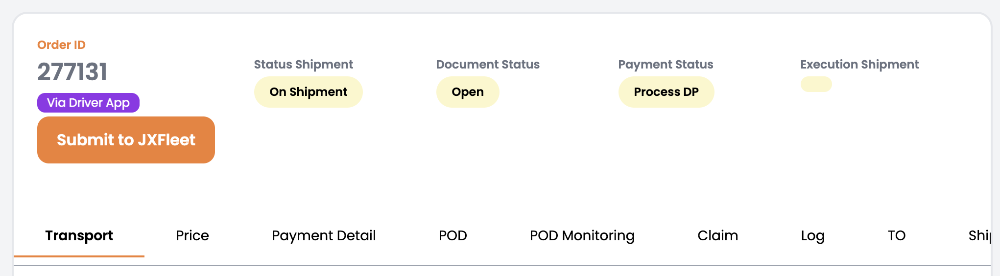
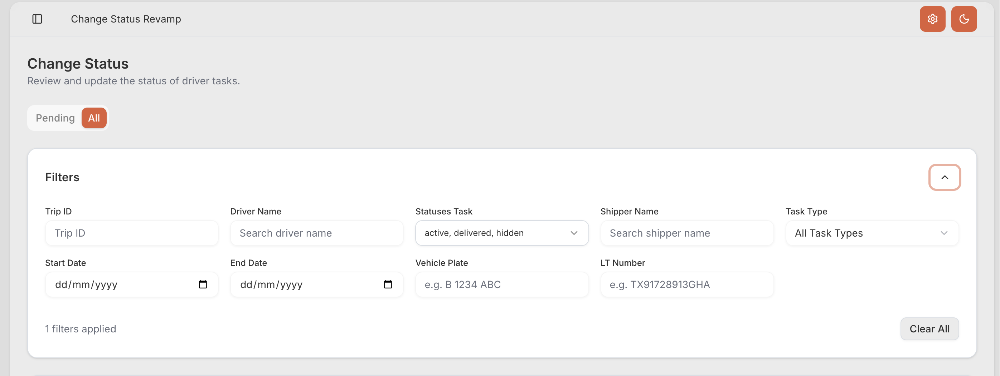

# Panduan Sinkronisasi Tugas Pengiriman (TMS ke JXFleet)

Panduan ini ditujukan bagi tim operasional untuk melakukan sinkronisasi penugasan pengiriman (*shipment task sync*) dari platform **TMS (Transport Management System)** ke sistem **JXFleet** secara manual, memastikan penugasan dapat segera diterima oleh mitra pengemudi pada aplikasi mobile.

---

!!! important "Batasan & Kondisi Sinkronisasi (Constraints)"
    - **Akses Lintas Peran**: Prosedur ini dapat dijalankan oleh berbagai peran internal operasional pada platform TMS, seperti **Driver Manager**, **Transport Control**, **Transport Express**, dan peran terkait lainnya.
    - **Kondisi Pemicu (*Trigger Condition*)**: Dilakukan ketika indikator penugasan otomatis seperti tag **`Via Driver App`** atau **`Driver App Notified`** belum muncul pada halaman detail pengiriman di TMS, yang menandakan data tugas belum terkirim ke sistem JXFleet.

---

## 🛠️ Langkah-Langkah Sinkronisasi Tugas Pengiriman

### 1. Masuk ke Platform TMS
Buka peramban (*browser*) komputer Anda dan akses sistem TMS melalui tautan resmi:
> [tms-jeje.web.app](https://tms-jeje.web.app)

Lakukan login menggunakan akun kredensial operasional Anda.

---

### 2. Membuka Halaman Detail Pengiriman (*Detail Shipment*)
Temukan penugasan pengiriman yang hendak disinkronkan melalui salah satu dari dua cara berikut:

- **Opsi A — Melalui Dashboard Peran**:
  Buka dashboard operasional sesuai peran Anda, cari penugasan berdasarkan **Order ID** pada tabel daftar shipment, lalu klik tombol **Detail Shipment**.

- **Opsi B — Melalui Pintasan Tautan Langsung (*Direct URL*)**:
  Akses langsung halaman detail shipment dengan memasukkan format URL berikut pada bilah alamat browser:
  ```text
  https://tms-jeje.web.app/ordermanagement/detailshipment/{ORDER_ID}
  ```
  *(Gantikan `{ORDER_ID}` dengan nomor Order ID shipment yang dituju, contoh: `277131`)*.

---

### 3. Mengirimkan Data ke JXFleet (*Submit to JXFleet*)

| Langkah & Instruksi | Tampilan Layar |
| :--- | :---: |
| Pada bilah informasi atas halaman **Detail Shipment**, cari dan tekan tombol berwarna oranye bertuliskan **Submit to JXFleet**. | { style="height: 180px;" .center } |

---

### 4. Menunggu Waktu Pemrosesan Sistem
Setelah tombol ditekan, sistem TMS akan mengirimkan *payload* penugasan ke server JXFleet melalui antrean pertukaran data (*API integration*).
> ⏳ **Beri jeda waktu sekitar 1 hingga 2 menit** agar proses integrasi dan pembuatan entitas tugas di JXFleet selesai seutuhnya.

---

### 5. Memeriksa & Memverifikasi Data di Portal JXFleet

| Langkah & Instruksi | Tampilan Layar |
| :--- | :---: |
| 1. Buka tab baru di peramban dan login ke portal [web.jxfleet.com](https://web.jxfleet.com).<br>2. Pada menu navigasi utama, masuk ke: **Shipment** ➔ **Change Status V2**.<br>3. Alihkan filter tab status dari **Pending** ke mode **All**.<br>4. Masukkan nomor Order ID penugasan pada kolom pencarian filter **Trip ID** untuk memverifikasi data. | { style="height: 240px;" .center } |

---

### 6. Evaluasi Hasil Sinkronisasi

Periksa kesesuaian seluruh data penugasan antara TMS dan JXFleet (nomor armada kendaraan, nama pengemudi, lokasi muat/bongkar, dan status shipment):

!!! success "Sinkronisasi Berhasil"
    Apabila rincian data antara TMS dan JXFleet telah sama persis, proses sinkronisasi dinyatakan **berhasil**. Mitra pengemudi yang ditugaskan dapat langsung membuka aplikasi **JXFleet Driver** di ponsel untuk melihat dan menjalankan tugas pengiriman tersebut.

!!! warning "Terdapat Ketidaksesuaian Data / Tugas Tidak Ditemukan"
    Apabila setelah 2 menit data penugasan belum muncul pada pencarian JXFleet atau terdapat perbedaan informasi signifikan antara kedua sistem, segera eskalasikan kendala tersebut kepada **Tim Pengembang JXFleet (JXFleet Developer Team)** untuk penanganan basis data lebih lanjut.

---