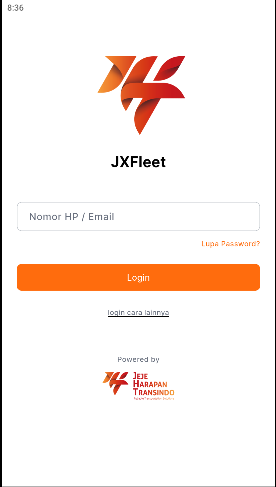
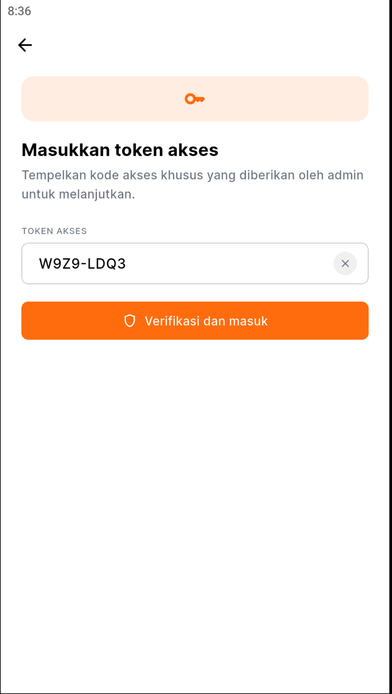
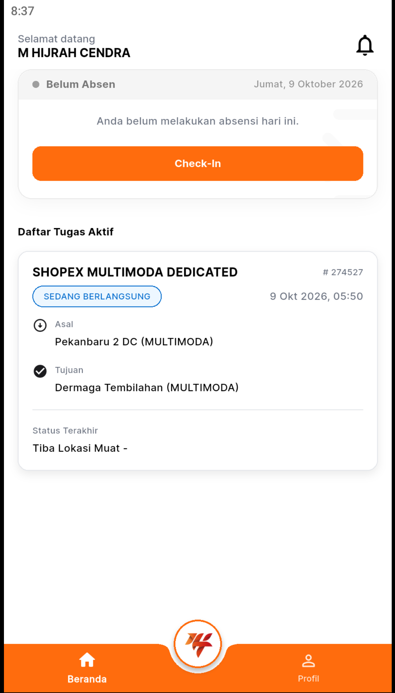
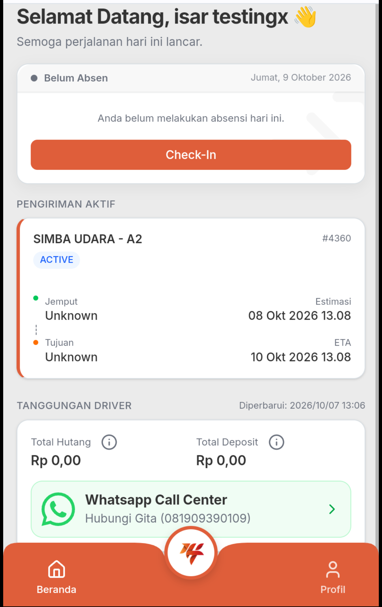
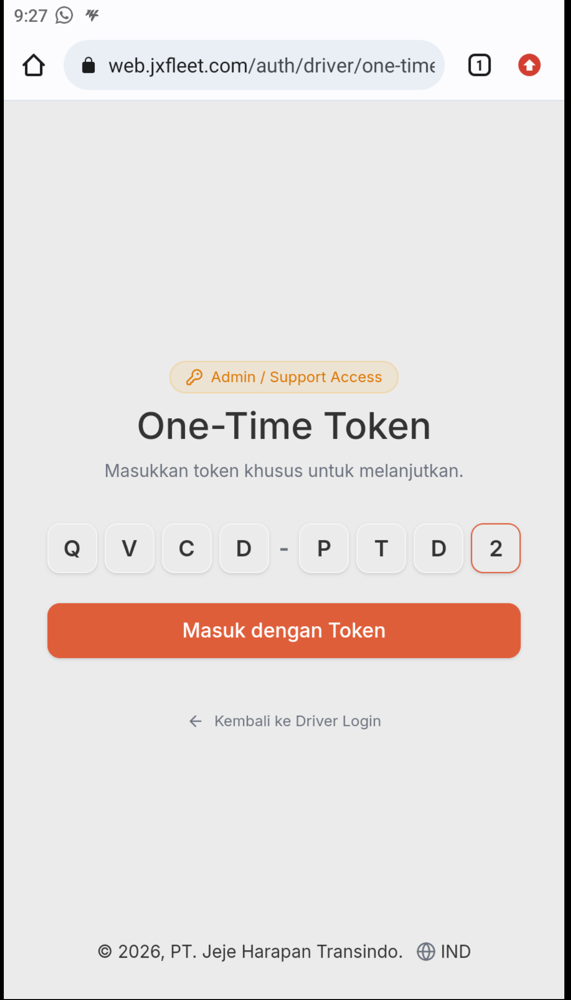
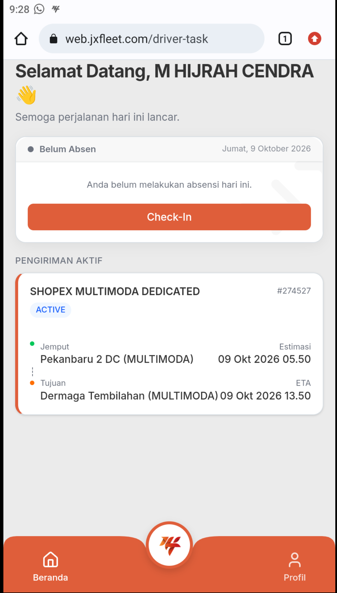

# Login Darurat Akun Driver Menggunakan One-Time Token

Dokumentasi ini menjelaskan prosedur masuk (*login*) darurat ke akun mitra pengemudi (*driver*) menggunakan **8-Digit One-Time Login Token**, baik melalui aplikasi **JXFleet Driver (Mobile App)** maupun peramban ponsel (**Mobile Web**).

---

## 📌 Latar Belakang & Kasus Penggunaan

Metode login menggunakan One-Time Token digunakan pada dua skenario operasional utama:

1. **Audit & Pemeriksaan Tim Internal**:
   - Tim internal (seperti *Driver Management*, *Operations Support*, atau *IT/Developer*) perlu melakukan audit, verifikasi penugasan, atau pengecekan tampilan aplikasi dari sisi pengemudi secara langsung tanpa harus meminta ataupun mengubah PIN pribadi pengemudi.
2. **Akses Darurat Mitra Pengemudi Lapangan**:
   - Pengemudi mengalami kendala tidak dapat masuk menggunakan PIN yang diingat (misalnya PIN terblokir atau lupa PIN), namun sedang berada dalam jadwal keberangkatan/muat armada yang sangat mendesak sehingga tidak memungkinkan menunggu proses penyetelan ulang (*reset*) PIN akun.

---

!!! info "Karakteristik & Ketentuan One-Time Token"
    - **Sifat Sekali Pakai (*Single-Use*)**: Kode token 8-digit hanya berlaku untuk **1 (satu) kali login**. Begitu pengemudi atau tim audit berhasil masuk ke sesi aplikasi, token langsung kedaluwarsa (*expired*) dan tidak dapat digunakan kembali.
    - **Tidak Mengubah PIN Asli**: Penggunaan token darurat sama sekali tidak mengubah atau mereset PIN akun driver yang tersimpan di sistem.
    - **Penerbitan Kredensial**: Kode token 8-digit diterbitkan oleh **Tim Driver Management** atau **Tim Pengembang JXFleet**.

---

## 🛠️ Tata Cara Login Menggunakan One-Time Token

!!! note "Sudut Pandang Mitra Pengemudi (Driver's Point of View)"
    Seluruh langkah-demi-langkah di bawah ini disusun dari **sudut pandang mitra pengemudi (*driver*)**, yaitu tindakan yang dilakukan langsung pada perangkat ponsel pengemudi di lapangan (baik dioperasikan secara mandiri oleh rekan driver maupun dipandu/diperiksa oleh tim internal).

Pilih platform yang digunakan pada ponsel driver:

=== "📱 Mobile App (Android / iOS)"

    Berikut adalah langkah-langkah yang dilakukan driver pada aplikasi **JXFleet Driver**:

    | Langkah & Instruksi (Sisi Driver) | Tampilan Layar Ponsel |
    | :--- | :---: |
    | **1.** Driver menghubungi Tim Driver Management atau Tim Pengembang JXFleet untuk meminta **8-digit One-Time Token**. | *(Diterbitkan oleh Admin / Support)* |
    | **2.** Buka aplikasi **JXFleet Driver** pada ponsel. Pada halaman awal, pilih menu **Login Cara Lainnya**. | { style="height: 250px;" } |
    | **3.** Masukkan atau tempelkan (*paste*) 8-digit One-Time Token yang telah diterima, lalu tekan tombol masuk. | { style="height: 250px;" } |
    | **4.** Sesi berhasil diverifikasi dan driver langsung masuk ke halaman utama aplikasi untuk melanjutkan tugas armada. | { style="height: 250px;" } |

=== "🌐 Mobile Web"

    Berikut adalah langkah-langkah yang dilakukan driver melalui peramban ponsel (*Chrome / Safari*) di `web.jxfleet.com`:

    | Langkah & Instruksi (Sisi Driver) | Tampilan Layar Ponsel |
    | :--- | :---: |
    | **1.** Driver meminta dan menerima **8-digit One-Time Token** dari Tim Driver Management atau Support JXFleet. | *(Diterbitkan oleh Admin / Support)* |
    | **2.** Buka peramban di ponsel, kunjungi [web.jxfleet.com](https://web.jxfleet.com), pilih **Login as Driver**, lalu klik menu **Login Cara Lainnya**. | { style="height: 250px;" } |
    | **3.** Masukkan atau tempelkan (*paste*) 8-digit One-Time Token pada kolom input yang tersedia. | { style="height: 250px;" } |
    | **4.** Sesi berhasil aktif dan driver langsung diarahkan ke tampilan dashboard tugas Mobile Web. | { style="height: 250px;" } |

---